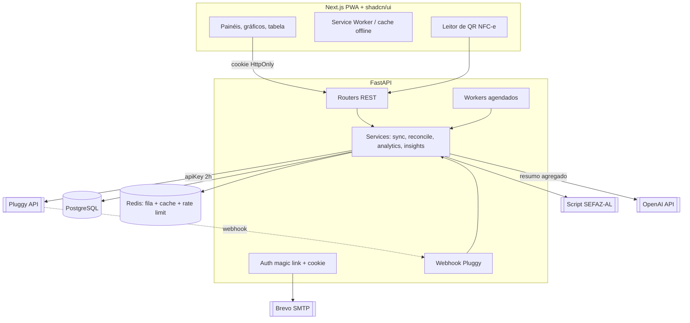
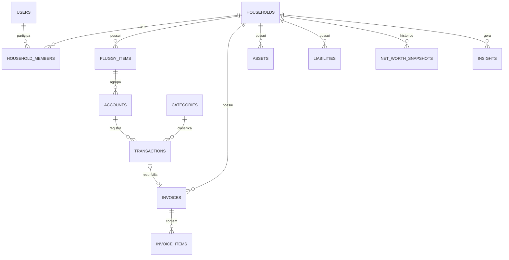
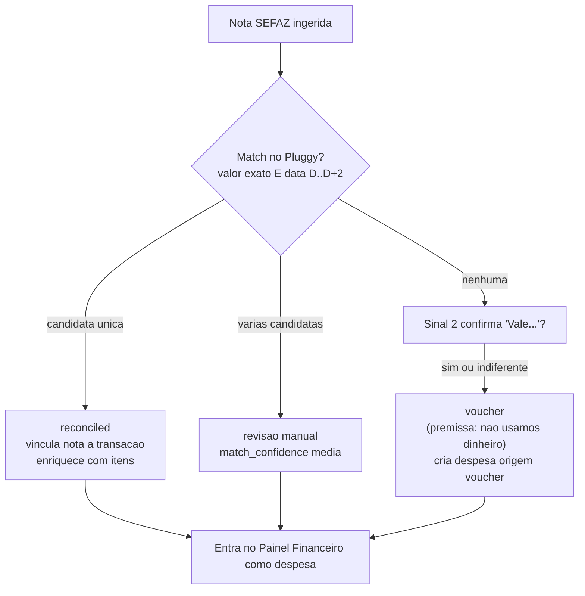

# PRD — Painel Financeiro Doméstico com Open Finance + SEFAZ + IA

**Versão:** 0.2 (reconciliação por 2 sinais + contrato real de ingest SEFAZ)
**Escopo:** aplicação de finanças pessoais para um casal ("contas da casa")
**Autor:** Mauricio Ferreira · **Data:** 2026-09-10

---

## 1. Resumo executivo

Aplicação web instalável (PWA) para controle financeiro doméstico de duas pessoas, que unifica três fontes de dados:

1. **Pluggy (Open Finance Brasil)** — contas, saldos, cartões, transações, investimentos e financiamentos, via rota gratuita do *Meu Pluggy* (development application + demo como proxy).
2. **SEFAZ-AL** — detalhamento item a item das notas fiscais (NFC-e/NF-e) a partir da URL do QR code, via script já existente.
3. **Entrada manual** — ativos e passivos que não vivem no Open Finance (imóveis, previdência privada, empréstimos informais).

O diferencial do produto é o **cruzamento SEFAZ ↔ Pluggy**: como a nota fiscal é emitida independentemente da forma de pagamento, uma nota **sem transação bancária correspondente** revela um gasto que o Open Finance não enxerga — tipicamente pago com **vale-alimentação/refeição** (VR/VA/Alelo/Sodexo/Ticket), que não está no trilho regulado. Isso permite um retrato de gastos mais completo do que qualquer app que dependa só do banco.

Sobre esse retrato unificado, o sistema entrega: painel financeiro com KPIs e gráficos, insights com IA (anomalias, tendências, risco de fluxo de caixa, plano para sair do vermelho) e um painel de patrimônio líquido com evolução histórica.

---

## 2. Objetivos e métricas de sucesso

| Objetivo | Métrica de sucesso |
|---|---|
| Enxergar 100% dos gastos, inclusive fora do banco | % de notas SEFAZ reconciliadas ou classificadas (meta: >95% das notas ingeridas resolvidas) |
| Reduzir esforço manual de categorização | % de transações auto-categorizadas (meta: >85%) |
| Dar clareza sobre saúde financeira | Taxa de poupança mensal e patrimônio líquido visíveis e atualizados diariamente |
| Antecipar problemas | Alertas de risco de fluxo de caixa emitidos com ≥7 dias de antecedência |
| Baixo custo operacional | Custo mensal de infraestrutura + OpenAI dentro de orçamento definido (ver §12) |

Fora de escopo nesta versão: iniciação de pagamentos, multi-moeda, mais de um household por conta, marketplace/multiusuário comercial.

---

## 3. Personas e modelo de acesso

- **Household (casal):** unidade que agrega os dados. Duas pessoas compartilham a visão consolidada das "contas da casa".
- **Membro:** usuário autenticado que pertence a um household. Cada membro conecta seus próprios itens do Pluggy; cada conta/transação pertence a um membro, mas é **visível para o household** e pode ser filtrada por membro ou vista como "casal (consolidado)".

**Premissa de compartilhamento (a confirmar — ver §14):** dados financeiros são compartilhados dentro do household por padrão. Não há, nesta versão, contas "privadas" invisíveis ao parceiro.

---

## 4. Fontes de dados

### 4.1 Pluggy (Open Finance)
- Autenticação server-side com `client_id`/`client_secret` (development application) → `apiKey` (validade 2h).
- Sincronização preferencialmente **por webhook** (`item/updated`, `transactions/created`) + **fallback diário** agendado.
- O proxy do *Meu Pluggy* atualiza os dados **uma vez por dia**; portanto, tempo real não é garantido e o produto deve comunicar "última atualização".
- Objetos consumidos: `Item`, `Account` (bank/credit/investment), `Transaction`, `Investment`, `Loan`, `Identity`.
- **Restrição operacional:** toda a configuração de conectores e as autorizações OAuth do *Meu Pluggy* devem ser feitas **durante o trial de 15 dias**; após expirar, o pull continua funcionando, mas a lista de conectores não é mais editável.

### 4.2 SEFAZ-AL (script existente)
- Entrada: URL da NFC-e (QR code do cupom). O script faz scraping da página pública da SEFAZ-AL (BeautifulSoup) e devolve **dois blocos**: cabeçalho/totais da nota e a lista de itens.
- Integração: o script será encapsulado como **módulo Python interno** `parse_nfce(url) -> Invoice` chamado por um endpoint de ingest (evita microserviço extra nesta fase — ver §14).
- Ingest pode ser: manual (colar URL / escanear QR pelo PWA) ou em lote.

**Contrato real de ingest (chaves que o script devolve hoje).** O mapeamento abaixo é a fonte da verdade para o parser e para o modelo `invoices`/`invoice_items`.

Cabeçalho/totais (`nota_info`):

| Chave retornada | Significado | Destino / normalização |
|---|---|---|
| `codigo_nota` | **chave de acesso** (44 díg., extraída do parâmetro `p` da URL) | `invoices.access_key` — **chave de dedupe** |
| `estabelecimento_nome` | razão social do emitente | `invoices.merchant_name` |
| `estabelecimento_endereco` | endereço do emitente | `invoices.merchant_address` |
| `cnpj` | CNPJ do emitente | `invoices.merchant_cnpj` (normalizar dígitos) |
| `Valor total R$` | valor bruto | `invoices.gross_amount` → **Decimal** (parse `pt-BR`) |
| `Descontos R$` | descontos | `invoices.discount_amount` → Decimal |
| `Valor a pagar R$` | valor líquido pago | `invoices.total_amount` → Decimal (usado no match) |
| `Qtd. total de itens` | contagem de itens | validação de integridade |
| `forma_pagamento` | forma declarada na nota (ex.: "Dinheiro", "Cartão…", "Vale…") | `invoices.payment_method_raw` — **sinal advisory, não confiável** (ver §8) |
| `valor_pago_na_forma` | valor pago na forma declarada | Decimal |
| `numero`, `serie` | número/série da NFC-e | `invoices.number`, `invoices.series` |
| `emissao` | data/hora `DD/MM/YYYY HH:MM:SS` | `invoices.issue_datetime` (parse para timestamp) |
| `protocolo_autorizacao` | protocolo | `invoices.protocol` |

Itens (`df_items`), um registro por produto → `invoice_items`:

| Chave | Destino |
|---|---|
| `produto` | `description` |
| `codigo` | `product_code` |
| `quantidade` | `quantity` (Decimal) |
| `unidade` | `unit` |
| `valor_unitario` | `unit_price` (Decimal) |
| `valor_total` | `total_price` (Decimal) |

> Observação: a versão atual do script **não extrai NCM**; o campo `invoice_items.ncm` fica opcional/nulo até ser adicionado ao parser.

**Endurecimento necessário antes de produção** (o script hoje é rascunho de notebook): transformar a `url` fixa em parâmetro de função; adicionar `timeout`, `retry` com backoff e `User-Agent` ao `requests.get`; **parsing defensivo** (checar existência de cada elemento antes de `.text`, pois a página quebra o parser se o layout mudar ou faltar um campo); usar **`Decimal`** para todo valor monetário com parser de formato brasileiro (`1.234,56`); e tratar/alertar falhas de ingest (scraping é frágil a mudanças de layout da SEFAZ).

---

## 5. Arquitetura do sistema



**Decisões de arquitetura**
- Backend em camadas: `routers` (HTTP) → `services` (regras) → `repositories` (SQLAlchemy async) → `models`. Schemas de entrada/saída em Pydantic v2. Migrations com Alembic.
- Jobs assíncronos com **Arq** (async, sobre Redis) ou APScheduler para o volume pequeno. Casos: sync diário Pluggy, snapshot mensal de patrimônio, geração de insights, reconciliação SEFAZ.
- Cache e rate limiting em Redis.
- Segredos (Pluggy, OpenAI, Brevo, chave de assinatura de cookie) fora do código, via variáveis de ambiente / secrets manager.

---

## 6. Modelo de dados (PostgreSQL)

Visão de entidades principais (campos-chave; tipos e índices detalhados em migration):

### 6.1 Identidade e auth
| Entidade | Campos principais |
|---|---|
| `users` | id, email (único), name, created_at |
| `households` | id, name, created_at |
| `household_members` | household_id, user_id, role (`owner`/`member`), joined_at |
| `magic_link_tokens` | id, email, token_hash, expires_at, used_at, ip_request |
| `sessions` | id, user_id, cookie_id (hash), created_at, expires_at, revoked_at |

### 6.2 Open Finance / contas
| Entidade | Campos principais |
|---|---|
| `pluggy_items` | id, household_id, member_id, pluggy_item_id, connector_id, institution_name, status, last_synced_at, error |
| `accounts` | id, household_id, member_id, item_id, pluggy_account_id, type (`bank`/`credit`/`investment`), subtype, name, number_masked, balance, currency (`BRL`), credit_limit, due_day |
| `transactions` | id, account_id, pluggy_transaction_id, date, amount (negativo=despesa), description, merchant_name, merchant_cnpj, category_id, type (`debit`/`credit`), status (`posted`/`pending`), installment_current, installment_total, source (`pluggy`), raw JSONB |
| `categories` | id, household_id (null=sistema), name, parent_id, kind (`expense`/`income`), color, icon, is_system |

### 6.3 SEFAZ / notas
| Entidade | Campos principais |
|---|---|
| `invoices` | id, household_id, member_id, access_key (44 díg., único), number, series, issue_datetime, gross_amount, discount_amount, total_amount, merchant_cnpj, merchant_name, merchant_address, source_url, **payment_method_raw** (texto cru da nota — advisory), **payment_status** (`reconciled`/`voucher`), matched_transaction_id (nullable), match_confidence, protocol, raw JSONB |
| `invoice_items` | id, invoice_id, description, product_code, ncm (nullable), quantity, unit, unit_price, total_price, category_id (inferida) |

> Mudança de modelagem (v0.2): removido o estado `cash` — o household **não usa dinheiro** (ver §8). A classificação final vira binária: `reconciled` (achou transação no Pluggy) ou `voucher` (não achou). `payment_method_raw` guarda o texto da nota apenas como pista/auditoria, pois é preenchido de forma não confiável pelo estabelecimento.

### 6.4 Patrimônio
| Entidade | Campos principais |
|---|---|
| `assets` | id, household_id, member_id, type (`cash`/`investment`/`real_estate`/`pension`), name, current_value, source (`manual`/`pluggy`), external_ref, valued_at |
| `liabilities` | id, household_id, member_id, type (`financing`/`credit_card`/`loan`), name, current_balance, original_amount, interest_rate, monthly_payment, due_day, source, external_ref |
| `asset_value_history` | id, asset_id, value, recorded_at |
| `liability_value_history` | id, liability_id, balance, recorded_at |
| `net_worth_snapshots` | id, household_id, ref_month, total_assets, total_liabilities, net_worth, debt_ratio, savings_rate |

### 6.5 IA e operação
| Entidade | Campos principais |
|---|---|
| `insights` | id, household_id, type, severity (`info`/`warning`/`critical`), ref_period, title, body, payload JSONB, model, generated_at, dismissed_at |
| `sync_logs` | id, item_id, started_at, finished_at, status, records_added, error |
| `ai_runs` | id, household_id, purpose, prompt_tokens, completion_tokens, cost_estimate, created_at |

### 6.6 Diagrama ER (resumido)


---

## 7. Requisitos funcionais

Notação: **US** = user story, **AC** = critério de aceite.

### F1 — Painel Financeiro
**US:** como membro do household, quero ver receitas, despesas e saldo do período com variação percentual e gráficos, para entender rapidamente a situação do mês.

- **F1.1 Cartões de KPI:** Receita, Despesa, Saldo (poupança) e Patrimônio, cada um com variação % vs período anterior.
  - AC: variação MoM = (atual − anterior) / anterior; sinal e cor (verde/vermelho) coerentes com o tipo de KPI (despesa subir = negativo).
- **F1.2 Gráfico de linhas:** tendência mensal de receita × despesa × saldo (últimos 12 meses).
- **F1.3 Gráfico de pizza:** divisão de despesas por categoria no período selecionado.
- **F1.4 Tabela de transações:** paginação, busca (descrição/merchant), filtros por intervalo de data, categoria, conta, membro e tipo.
  - AC: linha expansível mostra os **itens da nota SEFAZ** quando a transação estiver reconciliada.
  - AC: transações de **vale-alimentação** (origem SEFAZ sem banco) aparecem com selo/etiqueta distinta.
- **F1.5 Seletor de período** (mês, trimestre, ano, custom) que rege todos os widgets.

### F2 — Insights Financeiros com IA
**US:** como membro, quero análises e recomendações em linguagem natural, para saber o que está fora do padrão e como agir.

Sinais detectados (calculados de forma **determinística** no backend; ver §9):
- **F2.1** Despesas fora do padrão (outliers por categoria e transações individuais).
- **F2.2** Quedas consecutivas de receita (≥3 meses decrescentes).
- **F2.3** Custos crescendo mais que receitas (taxa de crescimento de despesa > receita no período).
- **F2.4** Meses de maior/menor eficiência (ranking por taxa de poupança).
- **F2.5** Risco de quebra de fluxo de caixa (projeção de saldo cruzando zero).
- **F2.6** Recomendações: sugestões de economia priorizadas, plano para sair do vermelho e estratégia para juntar dinheiro.
  - AC: cada insight tem tipo, severidade, período de referência e (quando aplicável) ações sugeridas com impacto estimado em R$.
  - AC: insights ficam cacheados; refresh automático mensal + botão "recalcular".

### F3 — Painel de Patrimônio Líquido
**US:** como casal, quero ver nosso patrimônio real e sua evolução, para acompanhar se estamos construindo riqueza.

- **F3.1 Ativos:** Dinheiro (saldos Pluggy), Investimentos (Pluggy), Imóveis (manual), Previdência (manual/Pluggy).
- **F3.2 Passivos:** Financiamento, Cartões (Pluggy), Empréstimos (Pluggy/manual).
- **F3.3 Métricas calculadas:**
  - Patrimônio Líquido Real = Total Ativos − Total Passivos.
  - Índice de Endividamento — **duas visões** (a escolher/exibir): endividamento sobre ativos = Passivos / Ativos; e comprometimento de renda = parcelas mensais de dívida / renda mensal líquida.
  - Taxa de Poupança Mensal = (Receita − Despesa) / Receita.
- **F3.4 Gráficos:** evolução histórica do patrimônio (a partir de `net_worth_snapshots`) e alocação de ativos (donut).
- **F3.5 CRUD manual** de ativos/passivos não-Pluggy, com histórico de valores.

### F4 — Ingest SEFAZ e detecção comportamental
**US:** como membro, quero registrar a nota fiscal do cupom e ter os itens detalhados, para enriquecer meus gastos e capturar compras fora do banco.

- **F4.1** Ingest por URL/QR (endpoint chama o script SEFAZ).
- **F4.2** Persistência de nota + itens; dedupe por chave de acesso.
- **F4.3** Reconciliação automática com transações Pluggy (ver §8).
- **F4.4** Classificação por dois sinais (match no Pluggy + `payment_method_raw` advisory): sem match ⇒ **vale-alimentação** (premissa: não usamos dinheiro). Ver §8.
- **F4.5** Gastos de vale-alimentação entram no Painel Financeiro como despesa de origem `voucher`, para não subestimar o total gasto.

---

## 8. Regra de negócio central: reconciliação SEFAZ ↔ Pluggy

Objetivo: para cada nota fiscal ingerida, decidir se ela corresponde a uma transação bancária conhecida; se **não** corresponder, classificar como **gasto via vale-alimentação** (fora do Open Finance).

**Premissa do household:** o casal **não usa dinheiro**. Logo, toda compra ou aparece no Pluggy (PIX/cartão, que estão no Open Finance) ou foi paga com **cartão de benefício** (Alelo/VR/Sodexo/Ticket), que roda no trilho de cartão mas **não está no Open Finance**. Não existe o caso "dinheiro em espécie".

**Dois sinais, com pesos diferentes:**
- **Sinal 1 — reconciliação com o Pluggy (autoritativo).** Match por `total_amount` exato **e** `issue_datetime` dentro de janela D..D+2 (defasagem de compensação), com reforço opcional por CNPJ do emitente × merchant da transação.
- **Sinal 2 — `payment_method_raw` da nota (advisory, não confiável).** A SEFAZ traz a forma declarada, mas o estabelecimento preenche errado (no exemplo real do notebook a nota dizia "Dinheiro" numa compra que **não** foi em dinheiro). Por isso este sinal **não decide** sozinho — só serve para (a) confirmar quando diz explicitamente "Vale Alimentação/Refeição" e (b) auditoria.

Como o dinheiro está descartado por premissa, a decisão colapsa em algo simples e robusto: **achou no Pluggy → `reconciled`; não achou → `voucher`.**



**Parâmetros e cuidados**
- **Sem match ⇒ voucher**, direto, porque a premissa elimina o dinheiro. `payment_method_raw` ("Dinheiro", "Cartão…", etc.) é ignorado para fins de decisão — guardado só como pista/auditoria. Se a nota disser explicitamente "Vale Alimentação/Refeição", isso apenas **eleva** o `match_confidence` da classificação `voucher`.
- **Salvaguarda:** se a premissa "não usamos dinheiro" mudar no futuro, basta reintroduzir uma confirmação leve na UI para os `voucher` de baixa confiança — o campo `payment_method_raw` já fica persistido para isso.
- Parcelamento: uma compra pode virar N transações parceladas; tratar soma de parcelas e/ou transação de autorização única antes de concluir "sem match".
- Idempotência: dedupe por `access_key`; reprocessar a mesma nota não duplica despesa.
- PIX e cartão de crédito/débito bancário aparecem no Pluggy → devem reconciliar. O "buraco" esperado é **exclusivamente** o vale-benefício.

---

## 9. Módulo de IA (arquitetura)

Princípio: **cálculo determinístico no backend, redação e priorização na LLM.** Isso deixa os números auditáveis, o custo baixo e reduz exposição de dados sensíveis.

**Pipeline**
1. Backend computa os sinais F2.1–F2.5 em Python (pandas/numpy) sobre dados agregados:
   - Outlier: por categoria, valor > média + 2·desvio-padrão dos últimos N meses (ou > p95); e outliers de transação individual.
   - Queda de receita: série mensal decrescente por ≥3 meses.
   - Custo × receita: comparação das taxas de crescimento (média móvel).
   - Eficiência: ranking mensal por taxa de poupança.
   - Risco de fluxo de caixa: projeção = saldo atual + receitas recorrentes previstas − despesas recorrentes previstas − parcelas futuras; sinaliza se cruza zero na janela de projeção.
2. Monta um **resumo estruturado agregado** (JSON) — sem números de conta, sem PII, apenas categorias, totais, séries e sinais.
3. Envia à OpenAI com instrução para retornar **JSON estruturado**: lista de insights (tipo, severidade, título, texto, ações com impacto estimado em R$).
4. Persiste em `insights` + registra custo em `ai_runs`. Cache até o próximo ciclo ou refresh manual.

**Privacidade/LGPD:** minimizar payload à OpenAI (agregados), nunca enviar credenciais, chave de nota, nº de conta. Documentar o uso de IA para os usuários.

---

## 10. API (FastAPI) — endpoints principais

| Método | Rota | Descrição |
|---|---|---|
| POST | `/auth/magic-link` | solicita link (rate-limited) |
| GET | `/auth/callback?token=` | valida token, cria sessão, seta cookie |
| POST | `/auth/logout` | revoga sessão |
| GET | `/auth/me` | usuário/household atual |
| GET | `/accounts` | contas do household (filtros) |
| GET | `/transactions` | lista paginada + busca + filtros |
| POST | `/pluggy/items` | registra/liga item |
| POST | `/pluggy/sync` | dispara sync manual |
| POST | `/webhooks/pluggy` | recebe eventos Pluggy |
| POST | `/invoices/ingest` | ingest de nota por URL |
| GET | `/invoices` / `/invoices/{id}` | consulta notas e itens |
| POST | `/invoices/{id}/resolve` | confirma vale ou seleciona a transação bancária |
| GET | `/analytics/kpis` | KPIs + variações |
| GET | `/analytics/trends` | série mensal |
| GET | `/analytics/expenses-by-category` | dados da pizza |
| GET/POST/PATCH/DELETE | `/assets`, `/liabilities` | CRUD patrimônio |
| GET | `/net-worth` / `/net-worth/history` | patrimônio atual e evolução |
| GET | `/insights` | insights cacheados |
| POST | `/insights/refresh` | recalcula insights |
| GET/POST | `/categories` | categorias |

Convenções: paginação por cursor, respostas Pydantic, erros padronizados (RFC 7807), escopo de dados **sempre** por household do usuário autenticado.

---

## 11. Autenticação — magic link + cookie (Brevo SMTP)

```mermaid
sequenceDiagram
    participant U as Usuário
    participant FE as Next.js PWA
    participant BE as FastAPI
    participant M as Brevo SMTP
    U->>FE: informa e-mail
    FE->>BE: POST /auth/magic-link
    BE->>BE: gera token aleatório, salva hash + expira em 15min (single-use)
    BE->>M: envia e-mail com link (token)
    M-->>U: e-mail com "Entrar"
    U->>FE: clica no link
    FE->>BE: GET /auth/callback?token=
    BE->>BE: valida hash, expiração, uso único; cria sessão
    BE-->>FE: Set-Cookie HttpOnly, Secure, SameSite=Lax (assinado)
    FE->>BE: requisições seguintes com cookie
    BE-->>FE: valida sessão a cada request
```

**Requisitos de segurança**
- Apenas emails cadastrados na base previamente terão ascesso.
- Cookie **HttpOnly + Secure + SameSite=Lax**, assinado; sessão opaca em `sessions` (revogável) ou JWT curto com refresh — a decidir (§14).
- Token de magic link: aleatório forte, guardado só como hash, expiração ~15min, **uso único**, invalidação dos anteriores ao emitir novo.
- **Rate limiting** por e-mail e por IP no endpoint de solicitação; proteção contra enumeração (resposta sempre neutra).
- Proteção CSRF para operações de escrita (SameSite + token quando necessário).
- Credenciais Pluggy/tokens **cifrados em repouso**; segredos só no servidor.

---

## 12. Requisitos não-funcionais

- **PWA:** instalável, manifest + service worker; leitura offline dos dados já sincronizados; layout responsivo (mobile-first mas também adaptado para desktop).
- **Segurança/LGPD:** dados financeiros são sensíveis — criptografia em trânsito (HTTPS) e de segredos em repouso; princípio do menor dado enviado à OpenAI; política de retenção e exclusão; consentimento e transparência sobre uso de IA; logs sem PII.
- **Performance:** endpoints de leitura < 300ms p95 sob dados do household; gráficos renderizam < 1s.
- **Confiabilidade:** jobs idempotentes; retries com backoff no sync Pluggy e no ingest SEFAZ; "última atualização" visível ao usuário.
- **Observabilidade:** logs estruturados, métricas de sync, custo de IA por período (`ai_runs`).
- **Backups:** dump diário do PostgreSQL com retenção definida.
- **Custo:** monitorar gasto OpenAI (agregação + cache mantêm baixo); infra enxuta (um Postgres, um Redis, um app).

---

## 13. Stack e organização

| Camada | Tecnologia |
|---|---|
| Frontend | Next.js (App Router) como **PWA**, shadcn/ui, Recharts (linhas/pizza/donut), TanStack Table (tabela) e TanStack Query (data fetching) |
| Backend | FastAPI, Pydantic v2, SQLAlchemy 2 (async), Alembic |
| Banco | PostgreSQL |
| Fila/cache | Redis + Arq (jobs) |
| Auth | Magic link + cookie assinado; e-mail via Brevo SMTP |
| Integrações | Pluggy API, script SEFAZ-AL (módulo interno), OpenAI API |
| Deploy | Contêineres (Docker); um serviço web + um worker |

---

## 14. Decisões em aberto / premissas a confirmar

1. **Compartilhamento no household:** tudo compartilhado entre o casal, ou permitir contas privadas? (premissa atual: tudo compartilhado) **DECIDIDO** tudo compartilhado
2. **Índice de Endividamento:** exibir Passivos/Ativos, comprometimento de renda, ou ambos? (premissa: ambos, com destaque para comprometimento de renda) **DECIDIDO** mostrar ambos
3. ~~Heurística de vale-alimentação~~ **DECIDIDO (v0.2):** household não usa dinheiro → sem match no Pluggy = `voucher`. `payment_method_raw` fica só como pista/auditoria. Estado `cash` removido do modelo.
4. **Sessão:** cookie de sessão opaca (revogável) vs JWT. (premissa: sessão opaca em tabela, mais simples de revogar) **DECIDIDO** o que for mais seguro
5. **Script SEFAZ:** encapsular como módulo interno (premissa) ou microserviço separado? **DECIDIDO** módulo interno 
6. **Ingest SEFAZ:** manual/QR nesta fase; automação futura fica fora de escopo? **DECIDIDO** manual escaneando o qr code da nota ou inserindo o código de verificacao da nota
7. **Frequência de valuation de investimentos/imóveis:** diária (Pluggy) e manual pontual — periodicidade do snapshot manual?
8. **Modelo OpenAI e orçamento:** definir o teto mensal e o modelo-alvo.

---

## 15. Riscos

| Risco | Mitigação |
|---|---|
| Rota gratuita do Pluggy depende do demo/proxy e pode mudar | Isolar integração atrás de uma interface; configurar tudo no trial; monitorar |
| Atualização Pluggy só diária | Comunicar "última atualização"; não prometer tempo real |
| `payment_method_raw` da nota vir preenchido errado | Não usar como sinal de decisão (só match no Pluggy decide); premissa "não usamos dinheiro" torna "sem match = voucher" seguro |
| Premissa "não usamos dinheiro" deixar de valer | `payment_method_raw` persistido permite reativar confirmação leve na UI sem migração |
| Custo/variabilidade da IA | Cálculo determinístico + cache + agregação; teto de gasto |
| Sensibilidade LGPD dos dados | Minimização, criptografia, retenção, transparência |
| SEFAZ-AL mudar layout/URL | Tratar erros do script; alertar quando ingest falhar |

---

## 16. Roadmap sugerido (fases)

- **Fase 0 — Fundação:** scaffolding FastAPI + Next.js PWA, PostgreSQL, Alembic, auth magic link, household/membros.
- **Fase 1 — Open Finance + Painel (F1):** integração Pluggy, contas/transações, categorização, KPIs e gráficos, tabela.
- **Fase 2 — SEFAZ + Reconciliação (F4/§8):** ingest, itens, cruzamento, detecção de vale.
- **Fase 3 — Patrimônio (F3):** ativos/passivos, métricas, snapshots e evolução.
- **Fase 4 — IA (F2/§9):** sinais determinísticos + geração de insights e recomendações.
- **Fase 5 — Endurecimento:** PWA polish, segurança/LGPD, observabilidade, backups.
